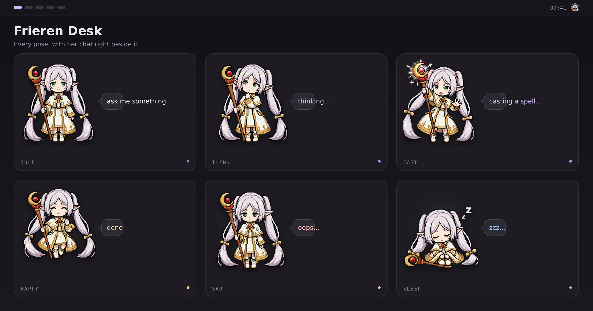

# Frieren Desk

A chibi Frieren that lives on your Hyprland desktop. Drag her around, click her
to chat with [opencode](https://opencode.ai), and ask her to read, edit or run
things on the system. She reacts to what is happening (thinking, casting,
success, error, sleep), wanders on her own, and minimizes to a real tray icon
with a settings menu.

## Install

Requires: [Quickshell](https://quickshell.org) 0.3+, [opencode](https://opencode.ai)
v2, Hyprland, Qt 6, and `python3` with `python-dbus` and `python-gobject` for
the tray icon. The opencode account is configured after install.

```bash
curl -fsSL https://raw.githubusercontent.com/jd-apprentice/frieren-desk/main/install.sh | bash
```

The installer downloads the latest `main` tarball and installs the Quickshell
config, the app menu entry, the launcher at `~/.local/bin/frieren`, the icon and
the opencode agent. It does not overwrite an existing agent file.

```bash
# overwrite the agent file
curl -fsSL https://raw.githubusercontent.com/jd-apprentice/frieren-desk/main/install.sh | bash -s -- --force

# remove the installed files (add --purge to delete the saved state too)
curl -fsSL https://raw.githubusercontent.com/jd-apprentice/frieren-desk/main/install.sh | bash -s -- --uninstall
```

From a clone, `./install.sh` does the same without downloading. Set
`FRIEREN_REF` to install a branch, tag or commit instead of `main`.

Then open **Frieren** from the app menu (or run `~/.local/bin/frieren`). Run it
again any time she is closed: it starts the pet and opens the chat, or toggles
the chat when she is already on screen.

On a fresh install, open the tray icon and choose **Connect OpenCode account...**
to paste an API key, or use **Terminal login** for providers that need a browser.
The chat shows a banner until the account is connected.

Add the keybind and autostart from `hypr/frieren.lua`, or bind:

```lua
hl.bind("SUPER + SHIFT + R", hl.dsp.exec_cmd("qs -c frieren ipc call frieren toggle"))
```

- Click the pet: open or close the chat.
- Drag her to the top bar or the bottom dock: minimize to the tray.
- Click the tray icon: show/hide, chat actions, animation settings and quit.
- State and settings: `~/.local/state/frieren/state.json`.

## What it looks like



| Pose | When it shows | Chat line |
| --- | --- | --- |
| `idle` | waiting, or wandering around | `ask me something` |
| `think` | opencode is reasoning | `thinking…` |
| `cast` | a tool is running | `casting a spell…` |
| `happy` | a task finished, or she wakes up | `done` |
| `sad` | an error came back | `oops…` |
| `sleep` | idle for a while with sleep enabled | `zzz…` |

The image is generated from the real sprites in
`quickshell/frieren/assets/poses/`, so it matches what you get after install.
Regenerate it with `python3 tools/make_poses_preview.py`.

## Docs

| Topic | Where |
| --- | --- |
| Config, tray menu and animations | `quickshell/frieren/README.md` |
| OpenCode account setup | tray menu, `quickshell/frieren/auth.py`, `components/AuthDialog.qml` |
| Persona and permissions | `opencode/agents/frieren.md` |
| Sprite sheet and icon pipeline | `assets/frieren-sheet.png`, `tools/slice_spritesheet.py`, `tools/make_icon.sh` |
| README showcase image | `tools/make_poses_preview.py` |
| Hyprland bind and autostart | `hypr/frieren.lua` |
| Installer and app menu launcher | `install.sh`, `tools/frieren-launch.sh` |

## Security

The pet runs real commands. The denylist lives in the opencode agent
(`opencode/agents/frieren.md`): no `sudo`, disk formatting, shutdown, remote
pipes or secret reads. It is a denylist, not a sandbox, so review the agent
before using it on a machine you care about.

## Contributing

PRs welcome. Keep the code and docs in English.

## License

MIT. See [LICENSE](LICENSE). Frieren is a fan-art sprite; the character belongs
to Kanehito Yamada and Tsukasa Abe.
