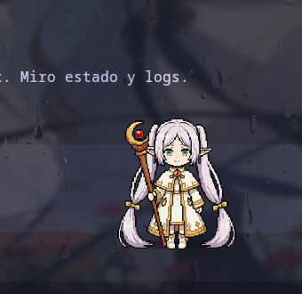
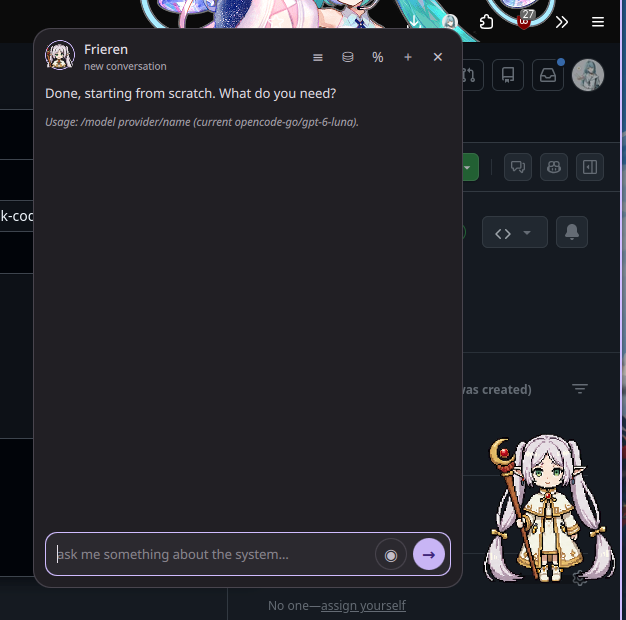
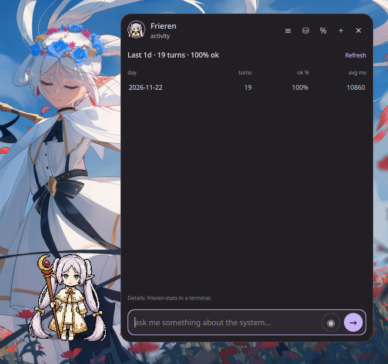
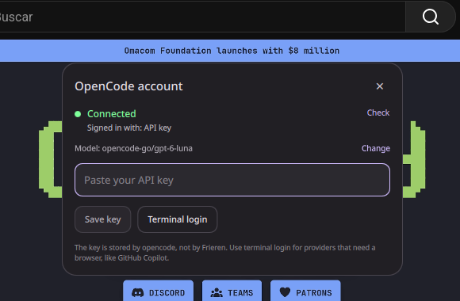

# Frieren Desk

A chibi Frieren that lives on your Hyprland desktop. Drag her around, click her
to chat with [opencode](https://opencode.ai), and ask her to read, edit or run
things on the system. She reacts to what is happening (thinking, casting,
success, error, sleep), wanders on her own, and minimizes to a real tray icon
with a settings menu.

## Install

Requires [Quickshell](https://quickshell.org) 0.3+, [opencode](https://opencode.ai)
v2, Hyprland, Qt 6, `sqlite3` (chat history and activity log), and a C toolchain
with the `gio` headers (on Arch: `base-devel` plus `glib2`).

```bash
curl -fsSL https://raw.githubusercontent.com/jd-apprentice/frieren-desk/main/install.sh | bash
```

Then open **Frieren** from the app menu, or run `~/.local/bin/frieren`. The
opencode account is configured from the tray menu after install.

## What it looks like


| Pose | When it shows | Chat line |
| --- | --- | --- |
| `idle` | waiting, or wandering around | `ask me something` |
| `think` | opencode is reasoning | `thinking…` |
| `cast` | a tool is running | `casting a spell…` |
| `reading` | a read-like tool is running | `reading…` |
| `happy` | a task finished, or she wakes up | `done` |
| `celebrate` | third clean turn in a row | `amazing!` |
| `sad` | an error came back | `oops…` |
| `sleep` | idle for a while with sleep enabled | `zzz…` |

### In action (real screenshots)

| | |
| --- | --- |
|  |  |
| On the desktop: click to chat, double-click for a fresh conversation, right-click for history. | Markdown replies, selectable text, copy buttons, slash-command completion. |
|  |  |
| Activity panel: turns, success rate and average time per day. | Account dialog: API key or terminal login, plus the model picker. |
|  | |
| About dialog: project, author, repository and license. | |

## Docs

| Topic | Where |
| --- | --- |
| Config, tray menu and animations | `quickshell/frieren/README.md` |
| Chat history and activity log | `quickshell/frieren/README.md` (History and activity log) |
| Architecture diagram (interactive) | `docs/architecture.html` |
| Project overview page (with sprites) | `docs/overview.html` |
| OpenCode account setup | tray menu, `quickshell/frieren/components/AuthDialog.qml`, `shell.qml` |
| Persona, permissions and command denylist | `opencode/agents/frieren.md` |
| Source sprite sheet (art reference) | `assets/frieren-sheet.png` |
| Sprite prompt for new poses | `assets/SPRITE_PROMPT.md` |
| Tray icon pipeline (development) | `tools/make_icon.sh` |
| Poses preview image (development) | `tools/make_preview.sh` (needs ImageMagick + DejaVu) |
| Hyprland bind and autostart | `hypr/frieren.lua` |
| Installer and app menu launcher | `install.sh`, `tools/frieren-launch.sh` |

## Contributing

PRs welcome. Keep the code and docs in English. See [CONTRIBUTING.md](CONTRIBUTING.md)
and the issue/PR templates in `.github/`.

## License

MIT. See [LICENSE](LICENSE). Frieren is a fan-art sprite; the character belongs
to Kanehito Yamada and Tsukasa Abe.
